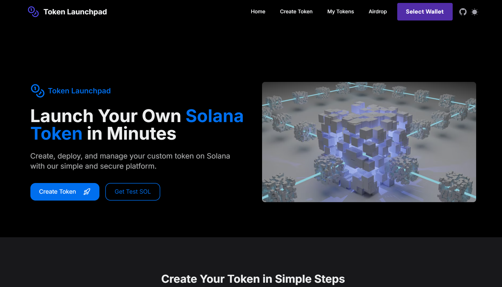

# Plataforma de Lanzamiento de Tokens Solana 🚀



Una plataforma moderna y fácil de usar para crear y gestionar tokens personalizados en la blockchain de Solana. Lanza tus propios tokens SPL en minutos con una interfaz hermosa e integración perfecta de billetera.

## ✨ Características

### 🎯 Creación de Tokens

- Crea tokens SPL personalizados con parámetros configurables
- Establece el nombre, símbolo y oferta inicial del token
- Sube y almacena imágenes de tokens en IPFS a través de Pinata
- Asignación automática de la autoridad de acuñación a la billetera del creador

### 💰 Gestión de Tokens

- Visualiza todos los tokens creados por tu billetera
- Acuña tokens adicionales según sea necesario
- Rastrea la oferta y distribución del token
- Almacenamiento descentralizado de imágenes en IPFS

### 🌟 Integración con Devnet

- Solicita airdrops de SOL para pruebas
- Despliega tokens en Solana Devnet
- Prueba la funcionalidad del token antes del lanzamiento en mainnet

### 🎨 Interfaz UI/UX Moderna

- Diseño adaptable para todos los dispositivos
- Soporte para modo oscuro/claro
- Conexión fluida con billeteras
- Retroalimentación de transacciones en tiempo real

## 🛠 Stack Tecnológico

### Blockchain y Web3

- Solana Web3.js
- SPL Token Program
- Solana Wallet Adapter

### Frontend

- React 18
- TypeScript
- NextUI Components
- TailwindCSS
- Lucide Icons

### Almacenamiento y Base de Datos

- IPFS via Pinata
- MongoDB Atlas

## 📦 Estructura del Proyecto

```
\
├── app/               # Páginas de rutas
│   ├── airdrop/       # Página de airdrop
│   ├── create/        # Página de creación de token
│   ├── mint/          # Página de acuñación de tokens
│   └── api/           # código backend
├── components/        # Componentes React para páginas
├── config/            # configuración del sitio y funciones backend
│   ├── solana.ts      # Integración con Solana
│   └── site.ts        # Configuración del sitio
├── models/            # Modelo de datos de MongoDB
├── types/             # Tipos de TypeScript
└── utils/             # archivos de utilidades para conexiones
```

## 🚀 Primeros Pasos

### Prerrequisitos

- Node.js 18+
- npm o yarn
- Una billetera Solana (p. ej., Phantom)
- Cuenta de MongoDB Atlas
- Cuenta de Pinata para IPFS

### Variables de Entorno

Crea un archivo `.env` en el directorio raíz:

```env
MONGODB_URI=your_mongodb_uri
MONGODB_URI_MAINNET=your_mongodb_uri_for_mainnet_data
PINATA_JWT=your_pinata_jwt
NEXT_PINATA_GATEWAY_URL=your_pinata_gateway_url
NEXT_PUBLIC_SOLANA_ENDPOINT=your_rpc_node_endpoint
NEXT_PUBLIC_SOLANA_NETWORK=your_network ( "devent" | "mainnet" )
```

### Instalación

1. Clona el repositorio:

```bash
git clone https://github.com/abhiraj2404/Token_launchpad.git
cd token_launchpad
```

2. Instala las dependencias:

```bash
npm install
```

3. Inicia el servidor de desarrollo:

```bash
npm run dev
```

4. Abre [http://localhost:3000](http://localhost:3000) en tu navegador

### Construir para Producción

```bash
npm run build
```

La salida de la compilación estará en el directorio `dist`.

## 📱 Uso

1. **Conectar Billetera**

   - Haz clic en "Connect Wallet" en la barra de navegación
   - Selecciona tu billetera Solana (p. ej., Phantom)
   - Aprueba la conexión

2. **Obtener SOL de Prueba**

   - Navega a la página de Airdrop
   - Haz clic en "Request Airdrop"
   - Recibe 1 SOL en Devnet

3. **Crear Token**

   - Ve a la página de Crear Token
   - Completa los detalles del token
   - Sube la imagen del token
   - Haz clic en "Launch Token"

4. **Gestionar Tokens**
   - Visita la página de Mis Tokens
   - Visualiza los tokens creados
   - Acuña oferta adicional
   - Rastrea los detalles del token

## 🤝 Contribuir

¡Las contribuciones son bienvenidas! No dudes en enviar un Pull Request.

1. Haz un fork del proyecto
2. Crea tu rama de funcionalidad (`git checkout -b feature/AmazingFeature`)
3. Confirma tus cambios (`git commit -m 'Add some AmazingFeature'`)
4. Envía a la rama (`git push origin feature/AmazingFeature`)
5. Abre un Pull Request

## 📄 Licencia

Este proyecto está licenciado bajo la Licencia MIT - consulta el archivo [LICENSE](LICENSE) para más detalles.

## 📧 Creador

Abhiraj Chauhan - [@abhiraj_2404](https://x.com/abhiraj_2404)

Enlace del Proyecto - [https://solanatokenlaunchpad.vercel.app](https://solanatokenlaunchpad.vercel.app)
